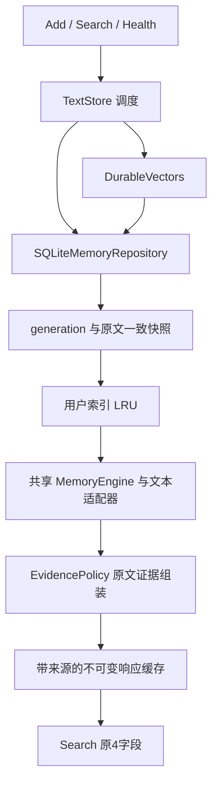

# 文本 HTTP v8：事务、检索和证据组装分层

2026-10-25。本轮只用原100题和本地缓存，不调用模型 API、不开新 subagent，也不产生新的 Answer/Judge 分数。HTTP v7 的部署包和报告保留；冻结离线 v7 继续不改动。

## 本轮改动

| 模块 | 责任 | 改动目的 |
|---|---|---|
| FastAPI app | 鉴权、请求大小、协议与错误响应 | 保持 Add/Search/Health 合同 |
| TextStore | 调度向量准备、按 generation 管理用户索引 | 减少存储细节与检索策略的耦合 |
| SQLiteMemoryRepository | 幂等检查、原文事务、generation 和一致读快照 | BM25与混合检索共用一套写入事务 |
| DurableVectors | 隔离、校验和持久化向量 | 每批读取最多200条，避免逐条SELECT |
| MemoryEngine / OnlineTextAdapter | BM25、dense、RRF/MMR及文本结构排序 | 冻结共享内核与离线文本适配器源码不变 |
| EvidencePolicy | 原文边界补全、会话合并、来源元数据 | 检索类不再访问内核私有 `_scopes`，不再维护单独窗口来源目录 |
| ResponseCache | 不可变结果、来源、条数与字节上限 | 窗口和会话框的来源随结果一起淘汰 |



这是一套服务内部的分层；代码和多模态可以继续复用事务、缓存和共享内核。HTTP 新适配器与多模态持久化结构仍需单独接入和验证，本轮没有宣称其他赛道已经完成服务接入。

## 持久化与并发语义

Add先按原规则计算请求签名与稳定消息ID。混合模式在原文事务外准备新增正文向量，再与BM25共用 `append`：幂等复核、请求、全部消息和 generation 在同一个 `BEGIN IMMEDIATE` 事务提交，成功确认在 FULL 同步提交之后。

部分消息写入失败会回滚整批原文、请求记录与 generation；已成功保存的向量可供重试复用，不会确认未提交的记忆。读取使用同一SQLite事务获取 generation 与原文；其他进程在两次读取之间提交时，当前搜索仍得到一致的旧快照，下一次搜索能看到新 generation。慢速向量准备不持有原文写事务。

向量批量读取仍按 user_id、namespace、document/query 类型和正文哈希隔离。IN查询使用绑定参数，每批最多203个参数，低于保守的999限制；输出恢复调用者顺序，重复正文不重复编码，所有向量继续校验维度、有限值和单位范数。任一批发现损坏即整次失败，无静默BM25降级。

数据库schema版本仍为1，原文、ID和向量格式兼容已有混合库，无需迁移或重新嵌入。已运行的v7实例不会被本地脚本自动升级。

## 检索质量验收

以归档 HTTP v7 为基线，两个独立本地Python进程按同一顺序运行原100题。每题比较全部 Search 记录的ID、正文、分数、创建时间及私有来源区间；另各重试 top_k=1和100。记录粒度和排序都不改变，不只比较汇总分。

本次100/100题完整响应和来源一致，每个版本额外200次top_k重试一致。首轮向量缓存SELECT从17,682次降到210次（减少98.81%，均包含100次查询向量读取）；重复请求的向量SELECT均为0。433项测试及18项本机HTTP检查通过。

LoCoMo沿用v7：同48k实际引用轮次token覆盖97.50%，完整48/50；运动75%、收养100%、州名0%。这些是检索指标，原始问答22/50（44分）保留。LongMemEval沿用原50题响应，证据指标分母仍47，拒答题没有移除。

新增故障测试覆盖两种检索模式的多消息中途失败与重试、另一进程在快照读取中提交、450条向量的批次边界/顺序/重复、混合命中与缺失、末批损坏。原有并发、增量写入、跨进程失效、重启与鉴权测试继续运行。

## 复现与产物

```powershell
$env:AML_ALLOW_EMBEDDING_API = '0'
$env:PYTEST_DISABLE_PLUGIN_AUTOLOAD = '1'
$env:OPENBLAS_NUM_THREADS = '1'
$env:OMP_NUM_THREADS = '1'
python -m pytest -q
python scripts/benchmark_service_v8.py --output runs/text_architecture_repeat
python scripts/smoke_hybrid_service.py --output runs/text_architecture_http_repeat
```

- `runs/text_architecture_probe_001/`：两个版本的100题完整响应与来源比较、向量SELECT计数和描述性时延；候选源码快照不属于正式部署包。
- `runs/text_hybrid_release_008/`：最终报告、测试与部署包。

对照重放缺缓存即失败，provider被替换为直接报错的占位对象，外网和DNS均禁止。原embedding缓存哈希和原44分对应537份文本结果/报告逐个校验。打包只包含运行源码和文档，排除评测数据、缓存和凭据。

时延是单次本机顺序重放，包含SQL计数开销，部分时段与测试并行，只作描述，不能据此推断生产吞吐。向量SELECT次数减少是确定的结构变化。冷索引仍会随generation重建；用户LRU按个数限制，未增加全进程内存容量保证，也未实现增量BM25或分布式存储。

这100题已反复用于开发，不是新题盲测。没有加载图片、构建Docker镜像、部署公网或执行官方Smoke/Full。
